# Address35

An address book whose contacts hold **any fields you like**, encrypted with the Sec35 password ([Getting started](Getting_started.md)). It reads vCards from an SD card, shows contacts synced from iCloud or CardDAV, and feeds [Datebook35](Datebook35.md) (birthdays, locations) and Phone Lookup.

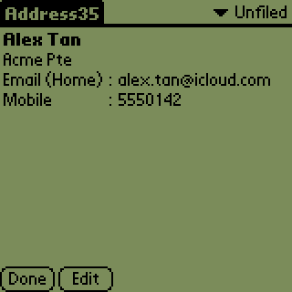

The list shows each contact's name and one value. **Options > Preferences** sets the sort order (two levels: last name, first name, company); **Options > Font** the list font. Category and Find work as in the built-in app.

## Fields
**New** shows a list of fields. Tap the triangle before a field name to change what it is (First, Surname, Company, Title, Email, Mobile, Address, birthday, relationship, social and more; the picker has a search box). **+ Field** adds a row, **- Field** removes one. A contact can have as many as you need.

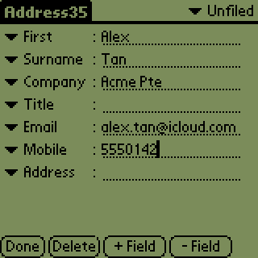

Some values are edited in their own box:

- **Email:** type the part before the `@`, choose the domain from the list (gmail.com, icloud.com, outlook.com and others, or tick **Other** to type your own) and a label (Home, Work, iCloud, Other).

  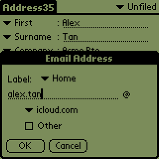

  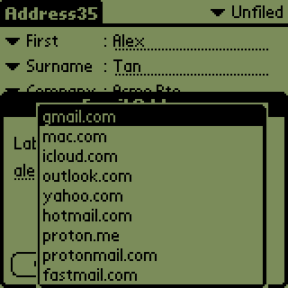

- **Phone:** pick the country for the dial code, then the number. It is saved as `+66 8123456`.

  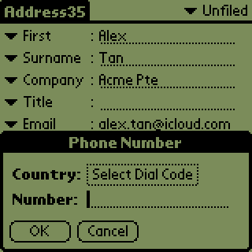

- **Address** and **Note** open full-screen editors; **dates** (birthday, anniversary) use digit boxes and work for any year.

Tap a contact in the list to see it; **Edit** goes back to the fields. **Record > Duplicate Contact** copies one.

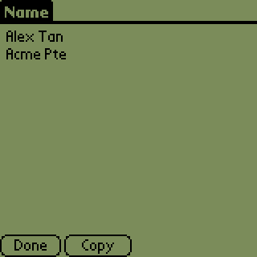

Tap a line in the contact to see the whole field, with a **Copy** button. **Edit > Copy Field** and **Edit > Copy Contact** copy the last tapped field or the whole contact.

> **Copied text is not encrypted.** It stays on the Palm's clipboard, where any app can paste it, even after Sec35 locks, until you copy something else.

## Using an SD card
With a card in (or served by the WiRSa, see [SASD](SASD.md)), the **Record** menu has three commands. Contacts are plain vCard files (`.vcf`, versions 3 and 4, photos are skipped):

| Command | What it does |
|---|---|
| **Browse Card** | Opens the card's `/Address` folder. Its `Import` and `Export` folders show as folders, and any vCards placed directly in `/Address` are listed. |
| **Import from Card** | Imports every vCard in `/Address/Import`. |
| **Export to Card** | Asks **This Category** or **All**, then writes one vCard per contact to `/Address/Export`. |

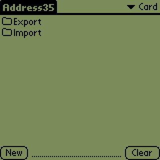

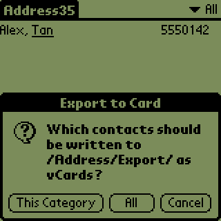

The category popup also has a **Card** row (after a divider) that does the same as Browse Card. Without a card, the app says "Insert an SD card".

## Contacts from iCloud and CardDAV
[CalDAV Sync](CalDAVSync.md) can keep an address book from iCloud or a CardDAV server on the Palm. In Address35 choose **Options > CardDAV...**, pick it in **Show:**, and the list switches to those contacts, with the title **iCloud - Contacts**. They are **read-only**. Tap one to read it; **Import** copies it into your own contacts. **Record > Import CardDAV...** imports everything on screen (Import, Skip Duplicates or Cancel). **Sync...** in the same box jumps to CalDAV Sync.

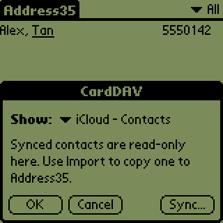

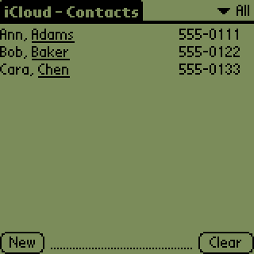

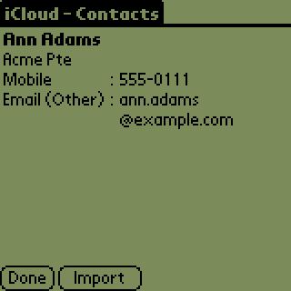

Their birthdays and anniversaries also show in Datebook35, and tapping one opens the contact here.
