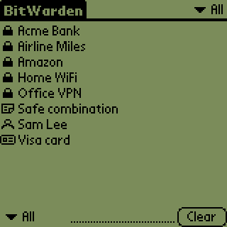
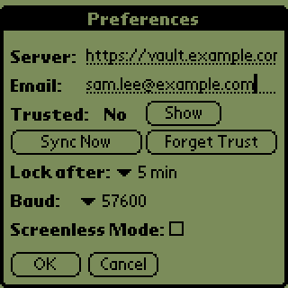
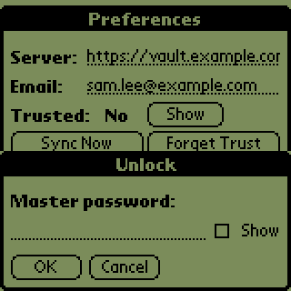
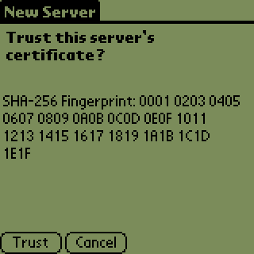
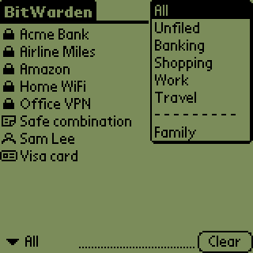
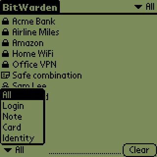
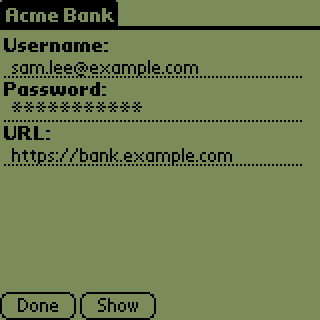
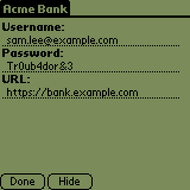
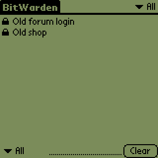
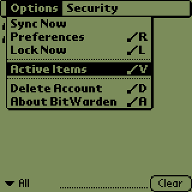

# BitWarden

A **read-only** copy of your Bitwarden or Vaultwarden vault on the Palm. The Palm does no network work: a **WiRSa** logs in, downloads and decrypts the vault, and sends it over the serial cable one item at a time. The Palm keeps the items encrypted with your Sec35 password ([Getting started](Getting_started.md)).

Needs: a WiRSa on WiFi ([WiRSa](WiRSa.md)), and the Sec35 password set. Tick **Screenless Mode** in Preferences and the app starts the WiRSa's BitWarden mode for you; otherwise choose **BitWarden Relay** on the WiRSa first (or in [WiRSaControl](WiRSaControl.md)).

## First sync
1. **Options > Preferences.** Enter the **Server** (the address of your Vaultwarden or Bitwarden server) and your **Email**.

   

2. Tap **Sync Now** and type your **master password**. It goes to the WiRSa for this sync only.

   

3. The first time, the app shows the server's certificate fingerprint. Check it, then tap **Trust**. It is remembered per server (**Forget Trust** in Preferences clears it).

   

4. If the account has two-step login, a keypad asks for the code. Tap **Cancel** on the progress screen to stop a sync at any time.

A short tune plays when a sync starts and ends. A new sync replaces the old copy only if it completes, so a failed one never loses your data.

## Finding things
- The pop-up at the top right lists your **folders**, then (below a line) your **organizations**.

  

- The pop-up at the bottom left filters by type: **Login**, **Note**, **Card** or **Identity**. The icon in each row shows the type.

  

- Type in **Find** at the bottom to narrow the list; **Clear** empties it.

## Reading an item
Tap an item. Passwords are hidden; **Show** reveals them (and the button then says **Hide**). Other fields follow the item type (card number and code, identity details, notes).

## Archived items
Items you archived in Bitwarden are **not mixed into the list**. Open **Options > Archived Items** to see only those; the menu entry then reads **Active Items**, which takes you back.

## Locking
The vault is hidden (`******`) when Sec35 is locked, after the **Lock after** time in Preferences, or when you choose **Lock Now**. **Delete Account** removes the local copy. **Security > 2FA** chooses how the two-step code is entered.
