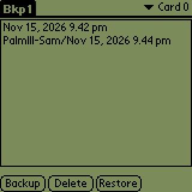
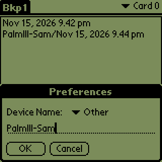
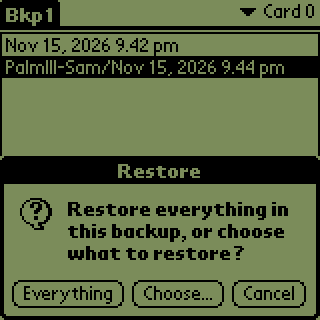
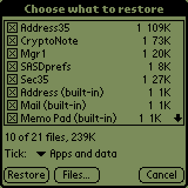
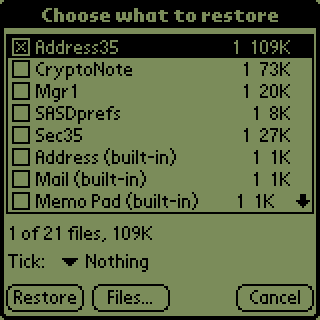
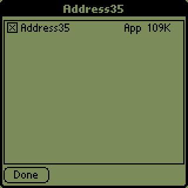
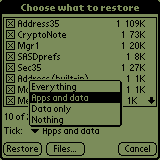

# Bkp1

Backs up everything on the Palm to a card and restores it, whole or in part. By Dmitry (from SASD), with fixes and the selective restore added. It works with any card the Palm can see: an SD card in the Palm, or the card on a WiRSa through [SASD](SASD.md). Without a card the app says "Expansion card support is needed".

## Backup
Tap **Backup**. Everything in the Palm's memory is copied, file by file, to a new folder on the card named with the date and time. The progress screen shows the file being copied and how far along it is, and **Cancel** stops it. Several backups can sit on one card. A backup of a Palm full of data takes several minutes over SASD.

Backups go to `/PALM/PROGRAMS/BKP1/` on the card. **The WiRSa's virtual card is 12 MB**, so a full backup of a big Palm may not fit; use an SD card for those. HotSync does not restore Bkp1 backups: restore with Bkp1.

## Several Palms on one card: device names and folders
Open **Options > Preferences** and set a **Device Name**. Choose **Other** and type a name (letters and digits, no `\ / : * ? " < > |`, up to 31 characters), or pick a name that already has a folder on the card. From then on a backup goes into `BKP1/<name>/<date time>`, and the list shows it as `PalmIII-Sam/Nov 15, 2026 9.44 pm`. **Not Set** goes back to plain `BKP1/<date time>` backups.

The list walks both kinds, sorted by name, so each Palm's backups sit together. **Backup > Rename** changes only the backup's own name, not its device folder. **Delete** removes the backup (its device folder stays). The Palm's hardware up and down buttons scroll the list a page at a time. The name belongs to this Palm: restoring another Palm's backup never changes it.

## Restore
Select a backup in the list and tap **Restore**. It asks:

- **Everything** puts back every file in the backup.
- **Choose...** lets you pick what comes back.
- **Cancel** does nothing.

When the restore finishes the Palm **resets**. A file that cannot be restored (a protected one, for example) is skipped and listed once at the end, and the rest carries on.

### Choosing what to restore
Bkp1 reads each backup and **groups the files by owner**: an application, hack or panel and all its data (matched by creator ID), the built-in apps' data, shared libraries and drivers, the system and application settings (Saved and Unsaved Preferences), and "Other data".

Each line is one owner with its box, file count and size. The box has three states: empty, partly ticked or fully ticked. The line at the bottom adds up what is ticked ("10 of 21 files, 239K").

- **Tap the box** to tick or untick the whole owner. A partly ticked owner becomes fully ticked.
- **Tap the name, then Files...** to see that owner's files, each with its own box, its kind (App, Data, Hack, Panel, Driver, Prefs, Lib) and size. Tick only the databases you want.

  

  

- **Tick:** applies a preset to everything at once.

  

| Preset | Restores |
|---|---|
| **Everything** | All files. |
| **Apps and data** | Applications and their data, the built-in apps' data, shared libraries and other data. Not hacks, panels, drivers, extensions or system settings. This is the default. |
| **Data only** | Databases without the applications. |
| **Nothing** | Clears every box, so you can tick a few. |

Tap **Restore**. A last question says how many files will be restored and what happens to settings.

### Settings and passwords
The two Preferences databases hold every app's settings plus the system's. If one is **ticked** it replaces the device's copy whole. If it is **not ticked**, the settings of each owner you did tick are copied back, and everything else, system settings included, is left alone. **Sec35's password data is kept in the settings, so encrypted records only unlock again after a restore if Sec35 is ticked too.** The presets *Everything* and *Apps and data* include it; *Data only* does not.

For the HackMaster Y2K35 suite, *Apps and data* does not include X-Master or X-Y2K35 (hacks). Tick those groups too, or install them separately.
