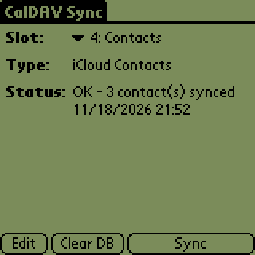
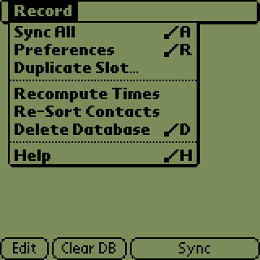
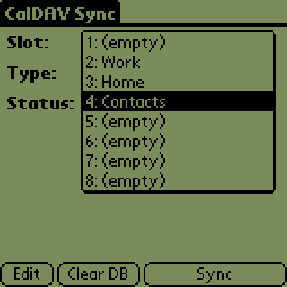
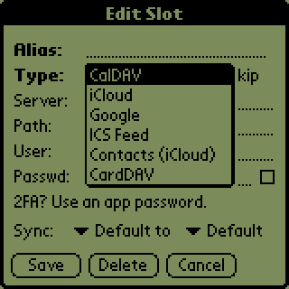
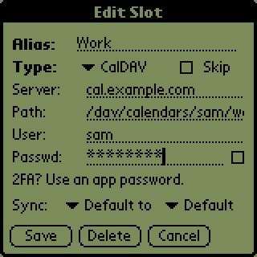
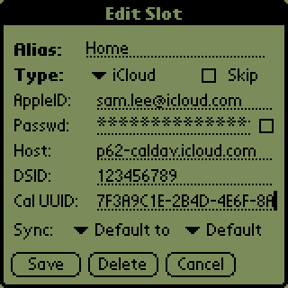
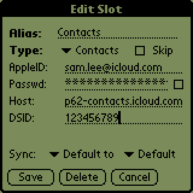
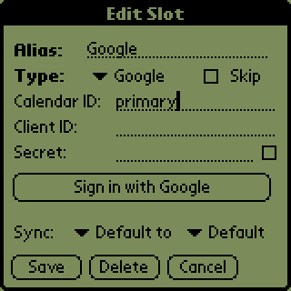
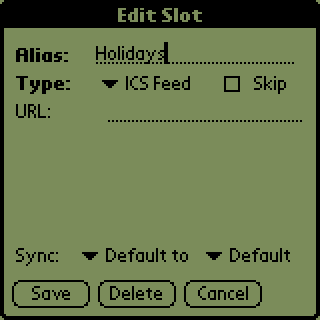

# CalDAV Sync

Brings your calendars and contacts onto the Palm, **read-only**. Calendar events appear in [Datebook35](Datebook35.md); contacts in [Address35](Address35.md), and their birthdays and anniversaries in Datebook35. Needs a WiRSa ([WiRSa](WiRSa.md)) with CalDAV Relay and the Sec35 password ([Getting started](Getting_started.md)). In WiRSaCtl or in this app's Preferences, turn on **Screenless Mode** and the app starts the WiRSa mode for you.

## Slots
Each calendar or address book is a **slot** (there are eight). The popup at the top picks a slot. **Edit** changes it, **Sync** fetches it, **Clear DB** removes only that slot's synced items. The **Record** menu has **Sync All**, Preferences, **Duplicate Slot**, **Recompute Times** (if you change the Palm's time zone), **Re-Sort Contacts** and **Delete Database**.

## Which type should I use?

| Your calendar | Use |
|---|---|
| Google Calendar | **ICS Feed** (simplest, but Google refreshes it every few hours), or **Google** (closer to live, more setup) |
| iCloud | **iCloud** (calendar) and **Contacts (iCloud)** (address book) |
| Nextcloud, Radicale, Fastmail, other | **CalDAV** (and **CardDAV** for contacts) |
| Any public `.ics` link | **ICS Feed** |

Tap a field to edit it; long ones open a full-screen editor. **Skip** leaves the slot out of Sync All.

## CalDAV (generic)

Server is the base URL from your provider (often ending in `/dav/` or `/remote.php/dav/`), Path is the calendar's own path, then user and password. With two-step login use an app password.

## iCloud: how to get the values

1. **AppleID** is your Apple ID. **Passwd** must be an **app-specific password**: sign in at appleid.apple.com, *Sign-In and Security > App-Specific Passwords*. Your normal password never works.
2. **Host**, **DSID** and **Cal UUID** are not shown anywhere on icloud.com. Find them once from a computer (any terminal, with your Apple ID and the app password):
   - `curl -v -u "you@example.com:app-password" https://caldav.icloud.com/` redirects to your server, something like `p62-caldav.icloud.com`. That is **Host**.
   - `curl -u "you@example.com:app-password" -X PROPFIND https://p62-caldav.icloud.com/ -H "Depth: 0" -H "Content-Type: application/xml" --data '<propfind xmlns="DAV:"><prop><current-user-principal/></prop></propfind>'` returns an `href` like `/123456789/principal/`. The number is your **DSID**.
   - Ask the same server for the principal's `calendar-home-set`, then list that folder: each calendar's folder name (a long UUID) is that calendar's **Cal UUID**.
3. For **Contacts (iCloud)** use the same Apple ID, app password and DSID, and Host `pNN-contacts.icloud.com` (same number as the calendar host). There is no Cal UUID.

## Google

**Easiest: ICS Feed.** In Google Calendar on the web: gear icon > *Settings* > your calendar > *Integrate calendar* > copy **Secret address in iCal format**, and paste it as the URL. Anyone with this link can read the calendar, so keep it private.

**Live sync: Google type.** One time, on your computer:
1. In the Google Cloud console create a project, enable the **Calendar API**, and create an **OAuth client ID** of type **Desktop app**. Note the **Client ID** and **Client Secret**.
2. Set the consent screen to **In production** (in *Testing* the sign-in expires after 7 days). If Google warns the app is unverified, add your account as a test user and continue through *Advanced*.
3. Paste the same Client ID and Secret into `google_auth.py` (in `apps/caldav_sync/tools/`).

On the Palm: set the slot type to Google, enter **Calendar ID** (`primary` for the main calendar), **Client ID** and **Secret**, then tap **Sign in with Google**. The Palm shows the WiRSa's IP and a PIN. On your computer run `python3 google_auth.py --ip <ip> --pin <pin>`, sign in in the browser, and the Palm stores the token. The PIN works for 5 minutes.

## What you see in Datebook35
Events carry the slot's alias in front. See [Datebook35](Datebook35.md#caldav-events).
