# CryptoNote

A memo pad that keeps your notes **encrypted**. It is the CryptoPad program with an AES-encrypted memo store, and it can also open **text files on an SD card**. It works like the built-in Memo Pad: **New** starts a memo, the first line is its title in the list, **Done** saves.

Two kinds of password are involved:

| Password | What it is for |
|---|---|
| **Sec35 password** ([Getting started](Getting_started.md)) | Unlocks the app and the encryption key the data is tied to. When Sec35 is locked, nothing opens. |
| **A password you choose for a memo** (or for a category, or for a card file) | A second lock on top. A memo with its own password cannot be read without it, even when Sec35 is unlocked. |

## Encrypt one memo
1. Open the memo. It must have **at least two lines**: the first line stays visible in the list as the title, everything after it is encrypted. A one-line memo is refused with "The memo should at least contain two lines."

   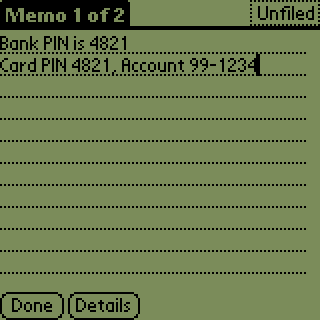

2. Choose **Record > Encrypt Memo...**. A **Password** box asks "Enter a password:". Type it and tap **OK**. Each character shows for a moment as you type it, then turns into `*`; tick **Show** to see the whole password. Every password box in CryptoNote works this way (memo, category, global password and card file).

   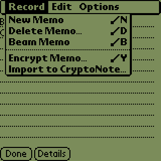

   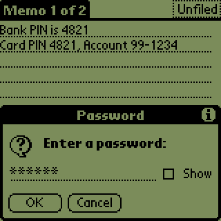

3. An "Encrypting..." box appears for a moment. Back in the list the memo now has a **key icon** at the right. Only its first line, the title, can be read.

   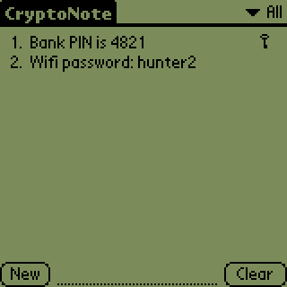

## Open an encrypted memo
Tap it. The same Password box appears, now with a **Forget...** button. Type the password and the memo opens. A wrong password is refused.

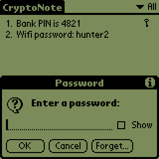

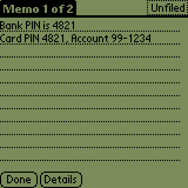

When you tap **Done**, the memo is **encrypted again with the same password**, without asking. While an encrypted memo is open, the **Record** menu shows **Remove Password** instead of Encrypt Memo: it turns the memo back into plain text.

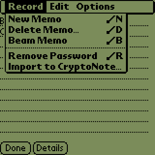

**Do not forget the password.** The memo cannot be recovered without it; **Forget...** only wipes the stored password, it cannot recover the text.

## A whole category
Use this to put one password on many notes at once.

1. In the category popup (top right) choose the category, or **All**.
2. **Record > Encrypt Category...**, then type the password in the Password box and tap **OK**.

   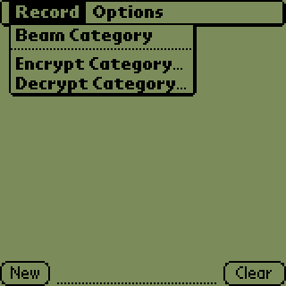

   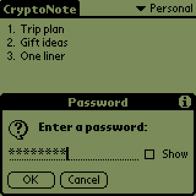

3. A box counts the notes as they are encrypted one by one ("Encrypting 3 of 5"). Each note takes a moment, as its password is stretched.

   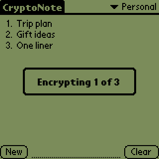

4. Back in the list, every note that was encrypted shows the **key icon**. Notes with only **one line** are left as they are (there is nothing to hide below the title), as are notes that already have a password.

   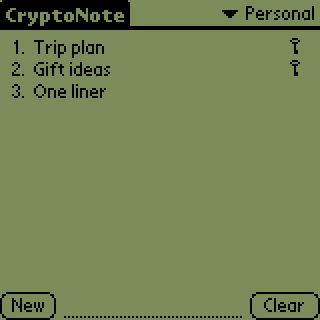

Open any of them with that password. **Record > Decrypt Category...** does the reverse: enter the password and every note in the category that has it loses its password (the key icons go). Notes with another password, or none, are left alone. The notes stay in CryptoNote, still protected by Sec35.

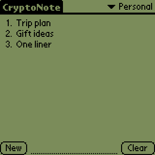

If nothing in the category can be encrypted (it is empty) the app says "The current category is already encrypted."

## Memo Details
In an open memo, tap **Details**. Besides the **Category** and **Private**, it shows:

- **Database**: where the memo is kept (see [More databases](#more-databases)).
- **Read-only**: tick it to stop the memo being changed or deleted.
- **Protection**: one line saying how the memo is protected:

  | Line | Meaning |
  |---|---|
  | Sec35 (this Palm) | In Main, no password of its own: Sec35 protects it. |
  | Sec35 + password | In Main, with its own password as well. |
  | Password + this Palm | In another database, with its password; only this Palm can open it. |
  | Password only | In another database, on a Palm without a device ID: its password alone protects it. |
  | Not encrypted | No password, and not protected by Sec35. |

- **Created** and **Modified**: when the memo was made and last changed. Memos from before this version show **Unknown** until they are next changed.

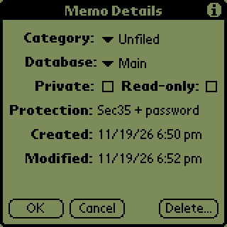

## The list icons
At the right of a memo's title, with no gaps between them:

| Icon | Meaning |
|---|---|
| Key | The memo has its own password. |
| No-entry sign | The memo is read-only. |
| Chip | The memo is in ROM (always read-only). |
| Database | The memo is in another database, not Main. |

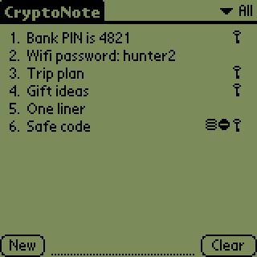

The list keeps your order, alphabetical or manual (**Options > Preferences**), across all databases. In manual order you can drag any memo, including one in ROM, to a new place. Choosing Alphabetical keeps your manual order; it comes back when you choose Manual again.

## Read-only memos
A read-only memo opens as usual (with its password, if it has one), but it cannot be changed: CryptoNote says "This memo is read-only" the first time you try to type, and **Delete**, **Encrypt Memo** and **Remove Password** are refused. Untick **Read-only** in Details to change it again. **Encrypt Category** and **Decrypt Category** leave read-only memos alone.

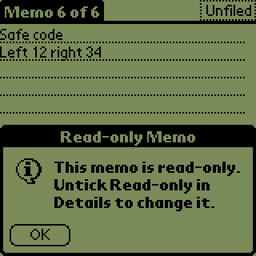

## More databases
Besides **Main** (CryptoNoteDB), CryptoNote can keep memos in databases you create, named `CryptoNoteDB_` plus a suffix you choose. CryptoNote shows the memos of all of them as one list. A database you no longer change can be moved into flash ROM with a program such as JackFlash, so its memos survive a hard reset.

**Options > Manage Databases** lists them. Tap one to see how many memos it holds, its size and whether it is in RAM or ROM.

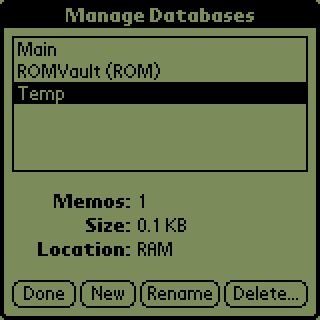

- **New** asks for the suffix. A name already used, in RAM or in ROM, is refused (a RAM database with a ROM database's name would hide it).

  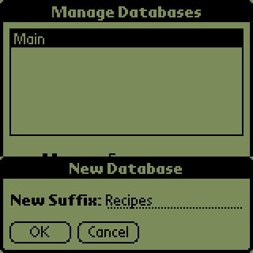

- **Rename** asks for a new suffix.
- **Delete...** asks to confirm, then deletes the database **and its memos**.

  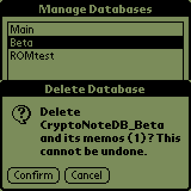

Main cannot be renamed or deleted, and neither can a database in ROM (move it back to RAM first).

**Moving a memo**: open it, tap **Details**, choose the database in **Database** and tap **OK**. **Create New...** at the bottom of that list makes a new database on the spot. The memo moves with its password, category, read-only flag and dates, and keeps its place in the list.

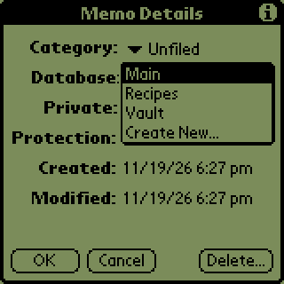

In another database a memo with a password is protected by **its password and this Palm's device ID** only: no Sec35, no global password, so it still opens after a hard reset once the database is back (from ROM). A Palm without a device ID uses a key stored in the database instead, and Details then says **Password only**. Memos without a password are plain text there.

**A database in ROM**: its memos open and can be read (with their passwords), but nothing in them can change. Details shows the database with "(ROM)", Read-only ticked, and refuses changes with "This memo is in ROM and cannot be changed". A ROM database cannot take new memos.

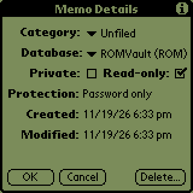

## Security
**Options > Security** shows whether this Palm has a **Device ID**, and sets **Privacy** (Show, Mask or Hide private records) like the Palm's own Security dialog. Showing private records asks for the Palm password, if one is set.

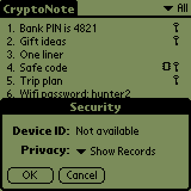

## Beaming
- **Record > Beam Memo** (in an open memo) sends it to another Palm's Memo Pad as plain text. A memo with its own password can be beamed too, once it is open: CryptoNote first warns that it will arrive as plain text that anyone receiving it can read. The memo on your Palm stays encrypted.
- **Record > Beam Category** (in the list) sends every note in the category, except notes with their own password and private notes. If some were left out, CryptoNote says how many; beam those one at a time from the memo.
- Card files are not beamed.

## Notes on the SD card
With a card in (or served by the WiRSa, see [SASD](SASD.md)) the category popup gets a **Card** row below a divider.

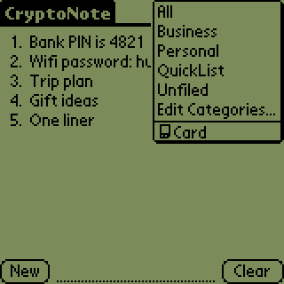

**Card** lists the text files in the card's **`/Notes`** folder (the app creates it the first time). Tap a folder to go in, or `[..]` to go up. `.txt` and `.md` files are listed, numbered like memos. An encrypted file is named `name.txt.enc`: the list hides the `.enc` and shows the key icon.

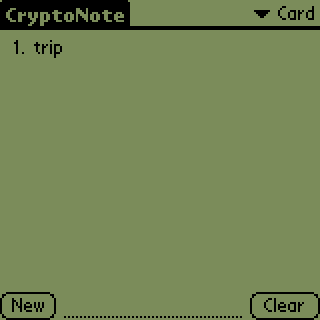

- **New** asks for a **Name** and creates the file.

  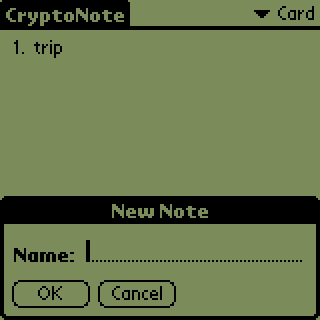

- Tapping a file opens it in the same editor as a memo, and **Done** saves it to the card.
- **Record > Encrypt Memo...** on a card file asks for a password and encrypts it. The original text file is replaced by `name.txt.enc`. Opening it later asks for the password, and it is encrypted again on Done.
- **Record > Import to CryptoNote...** copies the file into the Palm's own memos.
- On the card list, **Encrypt Category** / **Decrypt Category** work on every file in the folder with one password, after a warning that all of them are lost if the password is forgotten.

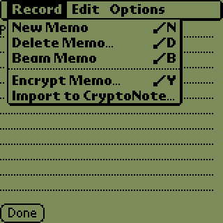
