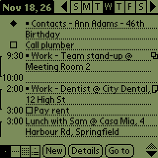
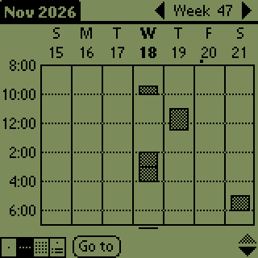
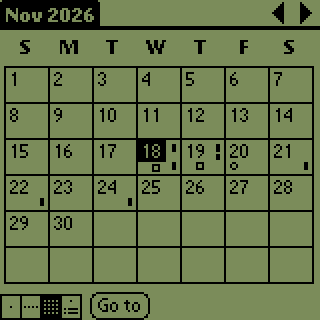
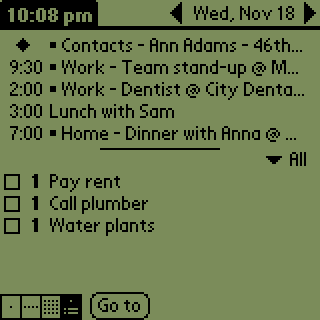
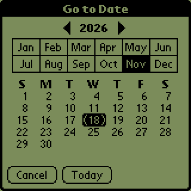
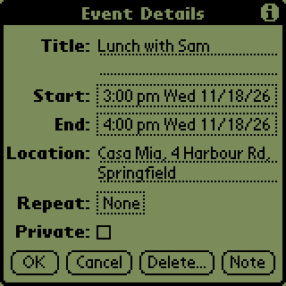
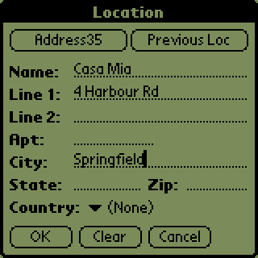
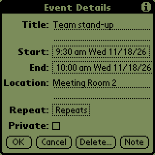

# Datebook35

The Date Book, rebuilt to show **any year from 1904 to 9999** and to bring together your own events, calendars synced by [CalDAV Sync](CalDAVSync.md), birthdays from [Address35](Address35.md) and the items of [ToDo35](ToDo35.md). It looks and works like the built-in Date Book; this guide covers what is different. It needs the plugin ([Getting started](Getting_started.md)). There are **no alarms**.

## At a glance
- Day, Week, Month and Agenda views with the usual buttons at the bottom left. **Go to** is not limited to 2031.
- A **Location** for every event, picked from your contacts or earlier locations.
- Events that run over **several days**.
- **CalDAV** calendars and **CardDAV** birthdays shown next to your own events.
- **ToDo35** items shown in the Day view and the Agenda.
- Event text is encrypted with the Sec35 password; locked events show `******`.

## Views

In the Day view the left and right arrows move **one day** at a time. With *Compress Day View* on (Options > Display Options) the view fits as many rows as it can without scrolling.

## Event details and Location
**Details** has a **Title** (two lines), **Start** and **End** (the end may be on a later day), **Location**, **Repeat** and **Private**. Tapping an existing event opens its details.

Tap **Location** to pick a place. Fill in the fields yourself, or tap **Address35** to take a contact's address, or **Previous Loc** to reuse a place you typed before. The place is kept in a list for next time.

In the Day view and the Agenda an event's location follows its title after an `@` (see *Lunch with Sam @ Casa Mia* above). A location is optional; clearing every field removes it.

Locations, including the list of previous ones, are encrypted with the Sec35 password like titles and notes. While Sec35 is locked, an event shows `******` without its location.

## CalDAV events
Events from CalDAV Sync appear **read-only** next to yours, in all four views. How they look:

- A small square and the **slot's alias** come first: `■ Work - Team stand-up @ Meeting Room 2`. Your own events have neither.
- The time sits in the normal time column, so they sort in with your own events. All-day events are listed untimed at the top.
- A note icon at the right means the event has a note; a repeat icon means it repeats.
- Tapping one opens the **same Details screen, view only** (you cannot change or delete it here). Change it in the calendar it came from and sync again.
- While Sec35 is locked, their text is hidden and a tap takes you to the unlock screen.

**Options > CalDAV Sync** jumps to CalDAV Sync to run a sync.

## Birthdays and anniversaries
Birthdays and anniversaries of your Address35 contacts, and of the contacts synced from CardDAV or iCloud, are listed untimed at the top of the day: `Contacts - Ann Adams - 46th Birthday`. Tap one to open that contact.

## ToDo35 items
Your ToDo35 items are part of the day. See [ToDo35](ToDo35.md#in-datebook35) for what appears where.

## Phone Lookup
In the Options menu, **Phone Lookup** searches your Address35 contacts (not the built-in Address Book) and pastes the number into the event.

## Beaming
**Record > Beam Event** sends the event as plain vCal, readable by any Palm or PC, **not encrypted**. Events beamed to you are encrypted the next time you open Datebook35 with Sec35 unlocked.
