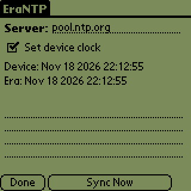
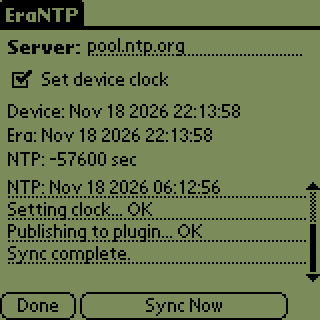

# EraNTP

Sets the Palm's clock from an **NTP time server** and tells the era plugin, so every app that depends on the date (Datebook35, ToDo35, Address35) sees the right time. It has one screen and no settings to save. Needs a network link for the Palm, normally the WiRSa in SLIP mode ([WiRSa](WiRSa.md)), and the plugin enabled ([Getting started](Getting_started.md)).

| Item | Meaning |
|---|---|
| **Server** | The NTP server. The default is `pool.ntp.org`; use any NTP host name or address. |
| **Set device clock** | On: the clock is set. Off: a **dry run**: it asks the server and shows the difference, but changes nothing. |
| **Device** | The Palm's clock now (updates every second). |
| **Era** | The date the era plugin reports. Past 2031 the Palm's clock is re-based so that the date stays valid; this row shows the true date. |
| **NTP** | After a sync, the difference in seconds between the server and the Palm's clock before it was set. |
| The box below | A step-by-step log of the last sync. |

## Sync
Tap **Sync Now**. The log shows each step:

1. `Querying pool.ntp.org...` and `Resolved: <address>`: the name was looked up.
2. `NTP: Nov 15 2026 22:15:24`: the time the server gave, in the Palm's own time zone (set in the Palm's Date & Time).
3. `Setting clock... OK`, then `Publishing to plugin... OK` (if the era plugin is active) and `Sync complete.`

If something fails the log says what (for example `FAILED: No reply from server`): check the link and try again. A reply that cannot be trusted (not from the server, or from a server whose own clock is not synchronized) is ignored, with `Ignored reply:` and the reason in the log. The **Network** menu has **Connect** and **Disconnect**, to bring the link up before you sync (useful on a slow link); the **Edit** menu works on the Server field.

EraNTP keeps working past NTP's own 2036 rollover: with the era plugin active it reads the right date as long as the plugin does (to the year 9999); without the plugin, until 2162.

Set the time zone in the Palm's Preferences first: the NTP time is UTC and is converted to the Palm's zone before it is shown and set. **Done** leaves the app.
