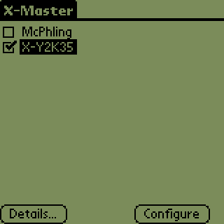
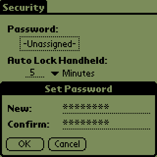
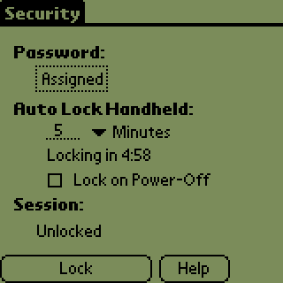

# Getting started

Datebook35, ToDo35, Address35 and EraNTP need the **X-Y2K35** plugin. CryptoNote, BitWarden, CalDAV Sync and the three PIMs share one password through **Sec35**.

## Turn on the plugin (X-Master)
Open **X-Master**, tick the box next to **X-Y2K35**. No reset needed. Without it, the apps say "Plugin Not Enabled".

## Set the password (Sec35)
Open **Sec35**, tap **-Unassigned-**, type the password twice. Everything the suite encrypts uses it.

Afterwards the box reads **Assigned**. The device locks itself after the time shown (**Auto Lock**); tap **Lock** to lock at once. Locked items show `******` and tapping one brings up the unlock screen.

**Lock on Power-Off** (tick it in Sec35) locks the moment the Palm turns off, whichever app was open.

### How safe is the password?
- **Use a long password, or a PIN of 8 digits or more.** Your data is encrypted with a key made from the password. Anyone who copies the data off the Palm (a HotSync backup on the PC, or a Bkp1 backup on a card) can try passwords on a computer as fast as it allows, without the Palm's wrong-password limits. A 4-digit PIN falls in moments that way; a long password does not.
- **Keep backups as private as the Palm.** A Bkp1 backup holds the encrypted data together with what ties it to this Palm, so the tie gives no extra protection to a card that is lost.
- **The wrong-password delay can be skipped by setting the clock forward.** After the 3rd wrong password Sec35 makes you wait longer each time; someone holding the Palm can change the date to get past the wait. The 10th wrong password still erases all encrypted data, whatever the clock says.
