# lazyFTP

An **FTP client** for the Palm. It browses a server folder by folder, previews text files, downloads and installs apps, uploads databases from the Palm, and manages files (cut, paste, rename, delete, new folder). It needs a network link for the Palm, normally the WiRSa in SLIP mode ([WiRSa](WiRSa.md)); it can talk to the WiRSa's own FTP server too, to put apps on the SD card.

## Connect
The Connect box opens when the app starts (and from **Network > Connect**).

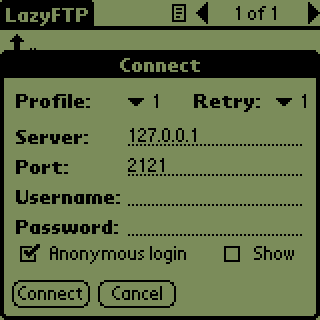

| Field | Use |
|---|---|
| **Profile** | Three saved connections (1 to 3). Pick one and its server, port and user are filled in. |
| **Retry** | How many times to try before giving up (1 to 3). Between tries the app counts down. |
| **Server**, **Port** | The FTP host (name or address) and port (21 unless the server uses another). |
| **Username**, **Password** | Your login. Each typed character shows for a moment and is then hidden; tick **Show** to see the whole password. |
| **Anonymous login** | Logs in as `anonymous` with no password. Ticked, it greys out the user and password. |

The connection is saved in the profile. The **password is stored encrypted** with your Sec35 password ([Getting started](Getting_started.md)), and a saved one shows as `*****`. If Sec35 is locked when you tap **Connect**, the app takes you to the unlock screen first.

## Browse
Once connected, the list shows the current folder: folders first (with a folder icon), then files with their size. The top row `..` goes up one level. `1 of 1` at the top is the page; the arrows move between pages of a long folder.

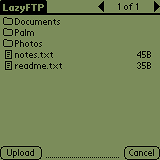

**Tap a row once to select it, tap it again to act.** The second tap on a folder opens it.

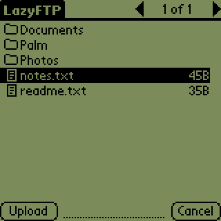

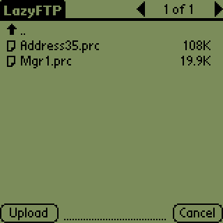

## Files
The second tap on a file opens a **File Action** box with its name.

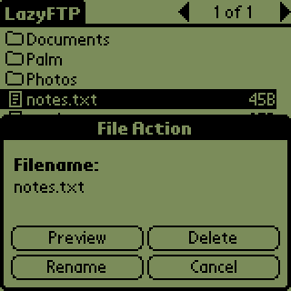

| Type of file | Buttons |
|---|---|
| Text (`.txt` and the like) | **Preview** reads it on the Palm. |
| `.prc` / `.pdb` | **Download** fetches it and installs it on the Palm. |
| Any | **Delete** (removes it on the server), **Rename**, **Cancel**. |

**Preview** shows the text. **Import to Memo** copies it into the Palm's Memo Pad; **Close** goes back.

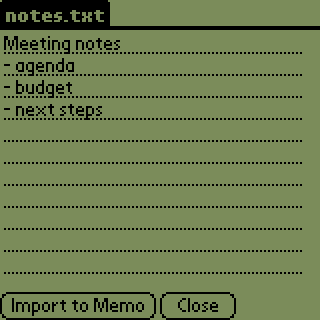

A `.prc` file offers **Download** instead of Preview:

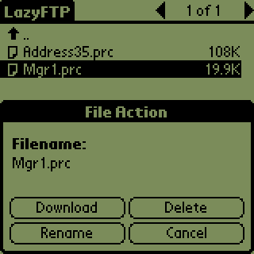

## Edit menu
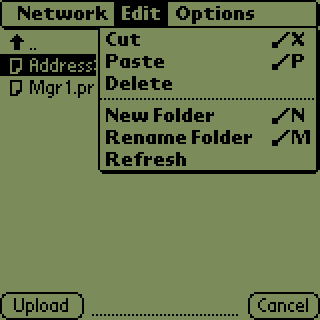

- **Cut** and **Paste** move a file or folder: select it, choose Cut (a small clipboard icon appears in the title bar while something is waiting), go to the target folder and choose Paste.

  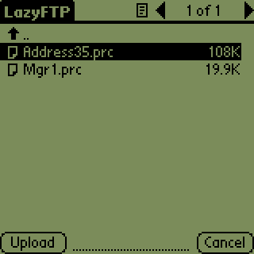

- **Delete**, **Rename Folder** and **New Folder** (which asks for a name) work on the current selection or folder. If nothing is selected the app says "Select an item first."

  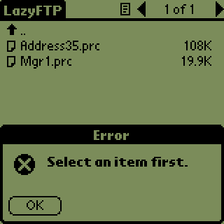

  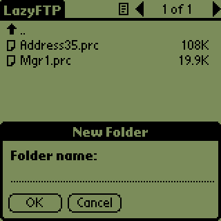

- **Refresh** reads the folder again.

Starting a new connection clears the cut buffer.

## Upload from the Palm
**Upload** (bottom left) lists every database on the Palm, with a find box at the bottom. Type to narrow the list, tap a row, and a **Remote name** box proposes the file name (for example `Address35.prc`). Edit it if you like and tap **OK**. A progress bar shows the transfer.

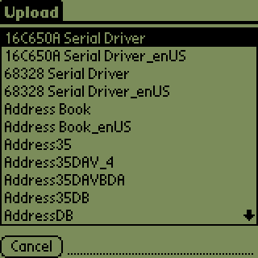

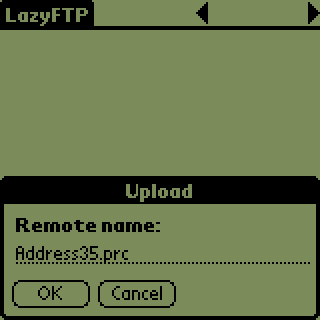

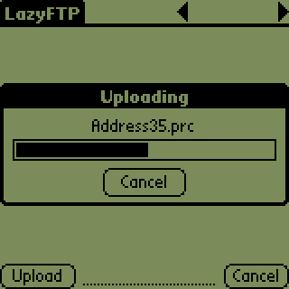

## The other menus
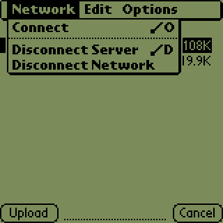

- **Network > Connect / Disconnect Server / Disconnect Network** control the link. Disconnect Server ends the FTP session; Disconnect Network also closes the Palm's network.
- **Options > Preferences** has **Large Dir Cache TTL** (how long a very long folder listing is remembered, to save time when you come back to it) and **Disconnect on exit**.

  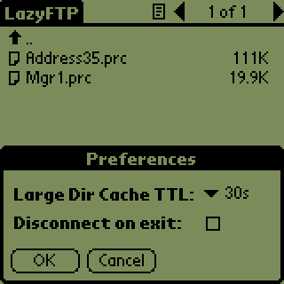

- **Options > Logs** shows the conversation with the server, line by line (your password is shown as `****`). Use it to see why a connection fails.

  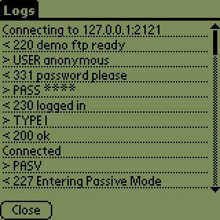
