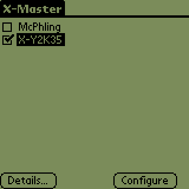

# McPhling

A launcher popup you call up with a swipe or a hardware button, listing your recent and favourite apps. It is a HackMaster hack: install it and tick it in X-Master ([Getting started](Getting_started.md)).

Select **McPhling**, tap **Details...** to set the swipe or button that opens the list. In the settings, **Apps:** opens the list, **Back:** jumps to the last app, and **Sel.:** assigns one of the four hardware buttons to launch the highlighted row, so the list can be used without touching the screen.
