# Meshtastic

Chat over a Meshtastic radio node. The Palm cannot do Bluetooth or the Meshtastic protocol, so the **WiRSa** holds the Bluetooth link to your node and the Palm talks to the WiRSa over the serial cable. The app shows channels, direct messages, the node list and the node's own settings, and keeps a copy for each node, so everything is there before you connect.

Needs: a WiRSa ([WiRSa](WiRSa.md)) with Mesh mode and a Meshtastic node in range with Bluetooth on.

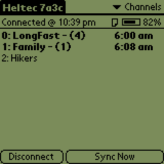

## First time
1. **Settings > Preferences.** Choose the **Baud** rate (57600 is a good start). Tick **Screenless Mode** if you want the app to find the WiRSa and start Mesh mode itself; without it, choose **Mesh[T]astic** on the WiRSa first. **SD History** keeps a copy of all texts on the WiRSa's SD card (off by default).

   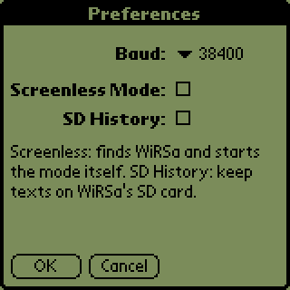

2. **Connect** (bottom left). The app finds the WiRSa, secures the link and waits while it connects to the node and loads its settings, channels and nodes. This takes 30 seconds or more the first time. When it is done the status line reads **Connected @ 10:39 pm** and the title shows the node's name.

   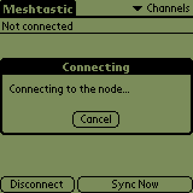

3. **Pair your node**, below.

## Pairing a node
**Settings > Device...** is where nodes are paired. Up to **four** nodes can be kept.

1. Tap **Scan**. The WiRSa lists the nodes it finds over Bluetooth, with their signal strength.
2. Tap your node, then **Pair**. Pairing can take up to a minute while the WiRSa reads the node's settings.

   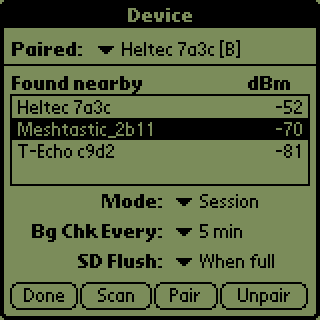

3. If the node shows a **PIN**, type it on the keypad and tap **OK**. A node that already knows the WiRSa asks for none.

   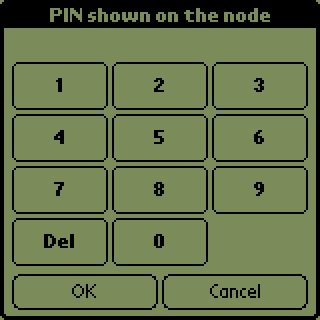

4. The node is added to the **Paired:** list and becomes the one shown.

   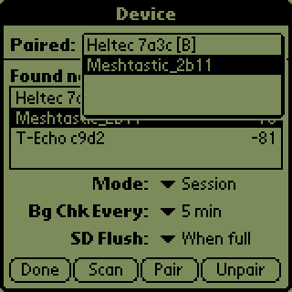

Pick another node in the **Paired:** list and the app switches to it: its saved messages appear at once, and Connect goes to that node.

## Unpairing
Select the node in the **Paired:** list and tap **Unpair**. The app asks what to do with its messages:

- **Keep** removes the Bluetooth pairing but keeps the node as an **archive**. Its messages stay on the Palm and on the WiRSa's card, **read only**.
- **Delete** removes the node, its messages and its folder on the card.

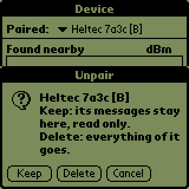

## Session mode and Background mode
Under **Mode:** on the same form, for the node shown:

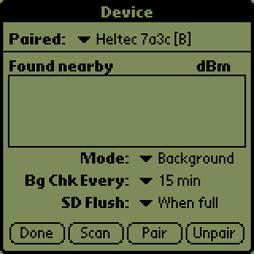

| Mode | What happens |
|---|---|
| **Session** | The WiRSa is in Mesh mode only while the app is open. Closing the app ends it. |
| **Background** | When you close the app the WiRSa goes back to its menu and **checks the node by itself** every **Bg Chk Every** (1, 5, 15, 30 or 60 minutes), keeping the new messages for the next time you open the app. Only one node can be Background; it is marked `[B]` in the list. |

In Background mode the WiRSa can sleep between checks (WiRSaControl > Setup > Sleep) and wakes on a timer. Messages wait in its memory, and on its SD card in `/Meshtastic/<node id>/`. **SD Flush** chooses how often they are written to the card while it sleeps (every check, every 3, 5 or 10 checks, or only when full, the default). To wake the WiRSa yourself, open the app and tap Connect.

## Reading and sending
The popup at the top right switches between **Channels**, **Direct Msg** and **Nodes**. Tap a row to open it. Unread chats are in bold with a count.

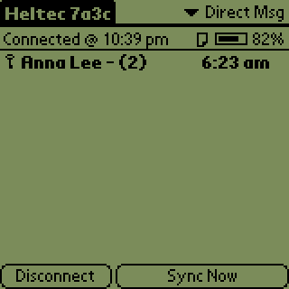

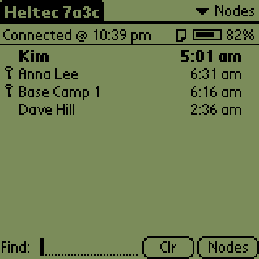

In a conversation each message shows the sender's short name in bold and the time at the right; your own start with `Me:` and carry a tick once delivered. New messages sit under a **New (N)** line next to the day heading. A message counts as read once it has been fully on screen for a second, or once you have scrolled past it. The count in **New (N)** goes down as you read, and the line goes when nothing is left. **Chat > Mark all read** asks first, then marks everything in the open conversation as read. A note symbol next to the battery means something is unread.

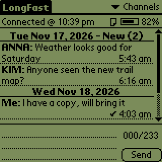

## Nodes
Tap a node in **Nodes** to see its card: names, id, signal, battery, hardware, role, position. **Favourite** marks it on the node; **DM** starts a direct message.

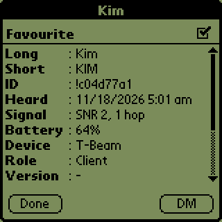

## Node settings and menus
**Node > Settings...** edits the node itself (owner, LoRa, role, Bluetooth, channels, MQTT, clock) and sends the changes together with **Save**. **Node > Sync Now** takes what the node holds now; **Clear Messages...** deletes on the Palm only. **Disconnect** hangs up. In **Channels**, a channel's key is shown as `*` characters, with the character you just typed in clear for a second. The checkbox at the right of the key shows all of it.

## Stored as plain text
Meshtastic does not use the Sec35 password. Messages, node names and the channel keys are kept on the Palm as plain text, and HotSync copies them to the PC backup. Anyone who has the Palm unlocked, or the backup, can read them.
