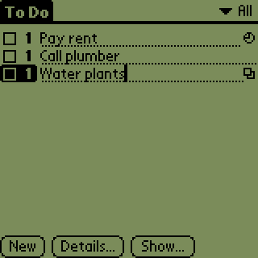
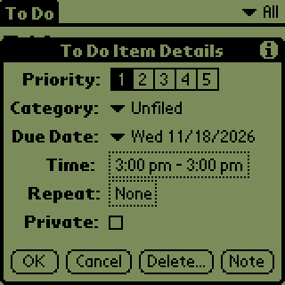
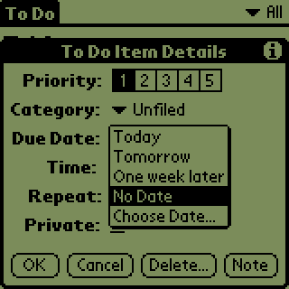
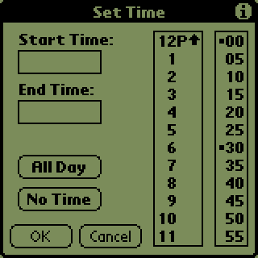
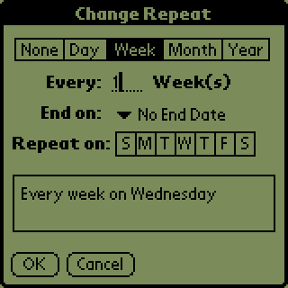
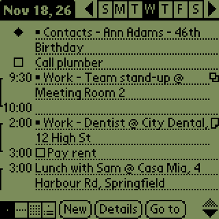
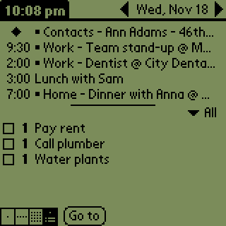

# ToDo35

The To Do list with a **time**, **repeats** and links to the calendar. Everything else works like the built-in To Do. Needs the plugin ([Getting started](Getting_started.md)). Descriptions and notes are encrypted with the Sec35 password.

Icons at the right of a row: a clock means it has a time, two squares mean it repeats.

## Details: due date, time, repeat

**Due Date** offers Today, Tomorrow, One week later, No Date or a date of your choice.

**Time** takes a start and an end time, or none.

**Repeat** opens a screen with None, Day, Week, Month and Year, how often (every 2 weeks), the weekdays, monthly by day or by date, and an end date. The box underneath says what you have chosen in words.

**A repeating item is not removed when you check it off.** Its due date moves to the next time it is due and it stays open, until the end date passes. An undated repeating item is simply completed.

## In Datebook35
ToDo35 and [Datebook35](Datebook35.md) share their items, with no extra setup:

- **Day view:** a small checkbox square marks a to-do. Items **due that day** show. **Today** also shows items with no date and overdue ones, at the top. An item with a **time** sits at its start hour, like an appointment.
- **Agenda:** the to-dos are listed under the day's appointments, with priority and category as in the list.
- **Tap a to-do** in either view and ToDo35 opens on it.

The Day view's Phone Lookup and the one in ToDo35 both search [Address35](Address35.md).

## Categories
The hardware To Do button cycles through the categories.

## Beaming
**Record > Beam Item** and **Beam Category** send items as plain vCal, readable by any Palm or PC, **not encrypted**. Items beamed to you are encrypted the next time you open ToDo35 with Sec35 unlocked.
