# WiRSa

A small ESP32-S3 box that connects the Palm to WiFi, to an SD card and to other devices. It runs **one mode at a time**: file server, app installer, card for the Palm, network gateway, and the relays behind BitWarden, CalDAV Sync and Meshtastic. This guide walks through setting it up and running each mode, in the two ways you can drive it:

- **Screen mode:** the OLED screen and the four buttons on the unit.
- **Direct serial mode:** a terminal program typing the menu letters over USB (or a Palm typing them over its serial cable).

A third way, [WiRSaControl](WiRSaControl.md) on the Palm, does most of this without touching the unit at all. A WiRSa built without screen and buttons is run only that way.

## What you need
- The WiRSa, powered over its USB port.
- A WiFi network (for FTP, SLIP, BitWarden, CalDAV and Meshtastic modes).
- A micro SD card (FAT16 or FAT32) **or** nothing: the WiRSa also has a built-in 12 MB **virtual card** named `ESP32`.
- The serial cable to the Palm (for everything that talks to the Palm).
- For direct serial mode: a computer with a terminal program (115200 baud, 8 data bits, no parity, 1 stop bit) and the USB cable plugged into the board's USB-serial port.

## 1. Screen mode

### The controls
Four buttons: **UP**, **DOWN**, **ENTER**, **BACK**.

| Button | Does |
|---|---|
| UP / DOWN | Move the arrow `▶` to the previous or next item. |
| ENTER | Choose the item. |
| BACK | Go back one menu; inside a running mode it stops the mode and returns to the main menu. |
| Hold ENTER | In a text or address entry: accept and finish. |
| Hold BACK | In an address entry: cancel. |

Menus show five items at a time; a small triangle at the right means there are more above or below.

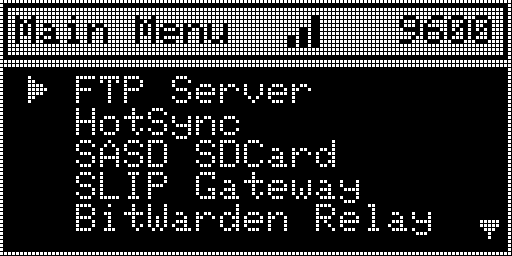

The top bar shows the menu name, the **WiFi signal** (three bars: solid while connected, climbing while it is trying, a cross when it gave up) and the **serial speed**. The speed is 9600 after every boot; WiRSaControl moves it up to the Palm's own speed.

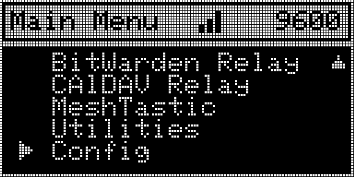

### First time: join your WiFi
1. Power the unit. After the start screen the **Main Menu** appears.
2. Go to **Config** (DOWN to the bottom, ENTER), then **WiFi Setup**.

   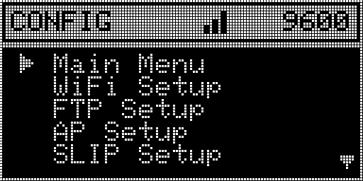

3. The WiRSa scans ("Scanning for WiFi networks...") and lists what it finds with four-star signal strength. Pick yours and press ENTER. **Cancel** is the last entry. An open network connects at once.
4. For a protected network the screen asks for the password. Enter it with the buttons:
   - **UP / DOWN** cycle the character shown (start at `a`).
   - A short press of **ENTER** adds that character.
   - **BACK** deletes the last one (with nothing typed, it goes back to the list).
   - **Hold ENTER** when the password is complete: the WiRSa says "Connecting..." and tests it.
5. On success the credentials are saved and the connection details are shown; press any button to continue. On failure it says "Connection failed! Wrong password?" and returns to the Config menu.
6. Check: the WiFi icon in the title bar shows solid bars, and **Utilities > Information** lists the network name, signal and **IP address**. You will need the IP for FTP.

If the network drops later, **Utilities > Retry WiFi** tries again (the WiRSa gives up after about a minute and a half and shows the cross).

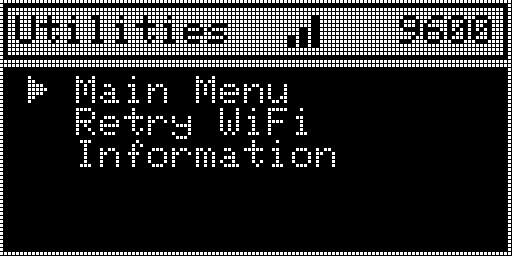

### Run a mode (screen mode)
Choose the mode in the Main Menu and press ENTER. Press BACK to leave. Each mode returns to the menu by itself after a quiet time (Config > **Exit Timers**).

| Mode | Steps |
|---|---|
| **FTP Server** | **Config > FTP Setup** first: set a user and password (leave both blank for anonymous login). Then **FTP Server > Start** (uses your WiFi) or **Start (AP Mode)** (the WiRSa makes its own WiFi network; set its name and password in **Config > AP Setup**; a password under 8 characters makes an open network). **Status** shows Started or Stopped. Connect an FTP client to the WiRSa's IP (port 21). The root has two folders, **SDCard** and **ESP32** (the virtual card). **Stop** when done. The server keeps running while you use other menus. |
| **HotSync** | Needs a card (SD, or the virtual one). Choose HotSync: the screen says `State: Waiting`. On the Palm press the HotSync button or tap HotSync. The state goes Connected, Syncing (file names scroll by), Completed. Everything in `/PALM/PROGRAMS/INSTALL` is installed (then moved to `INSTALLED`); `/PALM/PROGRAMS/SASD` is installed once. If a driver was installed the Palm resets itself. A short press of the **BOOT** button on the board is a shortcut for this mode. See [SASD](SASD.md). |
| **SAS[D] SDCard** | Choose it: the screen shows the card's used and total space and the transfer speed. On the Palm the card appears in Bkp1, CryptoNote, Address35 and file managers. BACK leaves. Which card is served (SD, virtual or automatic) is set in WiRSaControl > Setup > Disk. Cannot run together with the FTP server. |
| **SLIP Gateway** | Starts at once and shows its addresses and counters. Set the Palm's network connection to the same speed as the title bar, and the addresses to those in **Config > SLIP Setup** (defaults: gateway 192.168.7.1, Palm 192.168.7.2, DNS 8.8.8.8). BACK stops it. It also stops after a quiet time. This is how [lazyFTP](LazyFTP.md) and [EraNTP](EraNTP.md) reach the network. |
| **BitWarden Relay**, **C[A]lDAV Relay**, **Mesh[T]astic** | Choose the mode and leave it on `Waiting...`; then use the Palm app ([BitWarden](Bitwarden.md), [CalDAV Sync](CalDAVSync.md), [Meshtastic](Meshtastic.md)). The screen shows `Connecting...`, `Syncing...`, `Completed!`. The apps can start these modes themselves in Screenless Mode. |

### Network HotSync (HotSync to a computer through the SLIP gateway)
The Palm can HotSync with a **computer on your network** with no cradle at the computer: the Palm talks to the WiRSa over its serial cable, the WiRSa's **SLIP Gateway** puts it on your WiFi, and the Palm's **LANSync** reaches HotSync Manager on the computer. (This is separate from the WiRSa's own **HotSync** mode, which installs apps from a card.) It is the sequence of Palm settings that matters; the WiRSa itself only has to be on your WiFi and at its main menu.

**Speed: use 38400.** It is the most reliable rate for a network HotSync. 57600 can be faster on some Palms and 115200 gains nothing, but 9600 fails and anything above 38400 is more likely to time out. The same number goes in two places: the Palm's connection speed and the login script (`BR38400`). The WiRSa follows the script.

**What you need**
- The WiRSa on your WiFi ([join it](#first-time-join-your-wifi)). Its **SLIP** addresses can stay at their defaults (**Config > SLIP Setup**); the Palm takes its address automatically.
- A computer on the **same network** as the WiRSa's WiFi, running **HotSync Manager with LAN Sync enabled** (in HotSync Manager's menu: *Network*, or *LAN Sync* in the Setup dialog). Note the computer's **IP address**.
- The Palm connected to the WiRSa with the serial cable.

**1. A new connection, "Wirsa Hotsync".** Do not change an existing connection; make one just for the WiRSa so you can recognise it. In the Palm's **Preferences**, choose **Connection** and tap **New...**. Type the name **Wirsa Hotsync**, leave *Connect to* at **Modem** and *Via* at **Cradle/Cable**, then tap **Details...** and set the speed to **38,400 bps** and **Flow Ctl** to **Off** (the WiRSa does not use flow control).

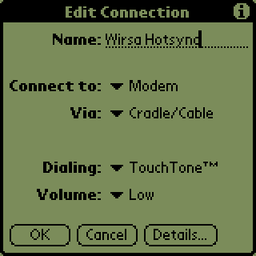

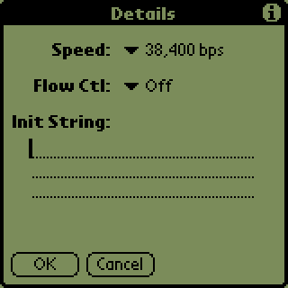

The new connection is now in the list:

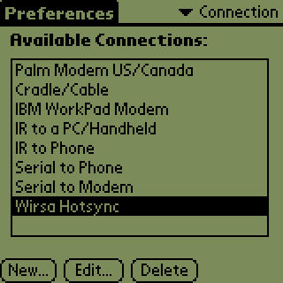

**2. The Palm network service.** In **Preferences > Network**, open the **Service** menu and choose **New**. Name the service **Wirsa Hotsync** and set **Connection** to the **Wirsa Hotsync** connection from step 1. Leave the user name, password and phone empty (the script does the login).

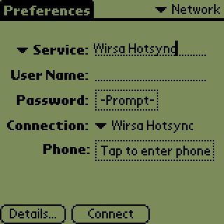

Tap **Details...** and set **Connection type: SLIP** (not PPP). Leave **IP Address** at **Automatic** and **Query DNS** ticked; nothing else is needed.

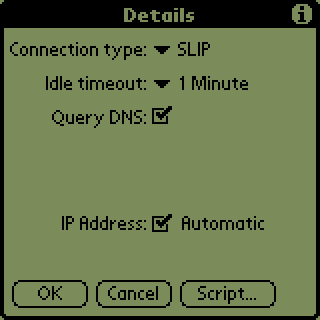

**3. The login script.** Still in Details, tap **Script...**. This script runs when the Palm connects. It tells the WiRSa the speed and then starts the SLIP gateway:

| Command | Text | Why |
|---|---|---|
| Send | `SETBAUD` | The WiRSa listens for this at any speed and measures the Palm's speed from it. |
| Wait For | `OK` | The WiRSa agrees. |
| Send | `BR38400` | The speed, the same as the Palm connection. The WiRSa checks it against what it measured and answers `OK`; if the two differ it answers `ERROR`. |
| Wait For | `OK` | Confirmed. The menu now runs at 38400. |
| Send | `S` | The menu key for **SLIP Gateway**. The gateway starts and the link is up. |

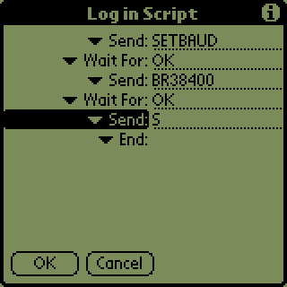

Do not add `Send CR`: a line also ends when the Palm pauses, and a lone `S` is taken as the SLIP key. After the script, the WiRSa shows the SLIP screen.

**4. HotSync's LANSync settings.** Open the **HotSync** application, then its **Options** menu:

- **LANSync Prefs...:** select **LANSync** (not *Local HotSync*).

  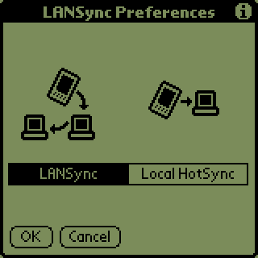

- **Primary PC Setup...:** the computer's **name** and its **IP address** (the address you noted), and the subnet mask if you want (`255.255.255.0` for most home networks).

  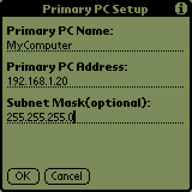

**5. Sync.** In the **HotSync** application tap **Modem** and select **Wirsa Hotsync** in the list under the button, so it names the connection. Make sure HotSync Manager is running on the computer and the WiRSa is at its main menu. On the Palm, tap the HotSync button (or **Connect** in **Preferences > Network**). The script runs (the WiRSa shows the SLIP screen with the speed in its title bar), the Palm joins the network, and the HotSync starts: the SLIP screen's `TCP:` count goes up as it talks to the computer.

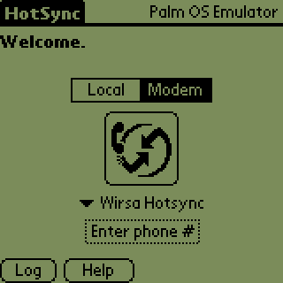

**If it fails:** use the [PocketTerm check](#test-the-palm-serial-line-with-pocketterm-ii) to prove the serial line at 9600 first; check that the speed in the Palm connection, the script and the WiRSa's title bar all say 38400; that `SETBAUD` and `BR38400` are spelled exactly; and that the computer's firewall allows HotSync Manager (LAN Sync uses TCP port 14238). The USB console prints the `SetBaud` lines (what the WiRSa heard and why a `BR` was refused) and a `SLIP stats` pair of lines every 10 seconds while traffic flows.

### What each mode shows
Every mode has the same title bar: the mode's name, the WiFi signal, and the serial speed *right now* (it changes during a sync, for example from `9600` to `57.6k`). Below it:

**HotSync:** `State:` is Waiting, Connected, Syncing, Completed (or Init Complete, when the `SASD` driver folder was installed). `Details:` is a two-line log of what is happening: the folder being checked and the file being installed.

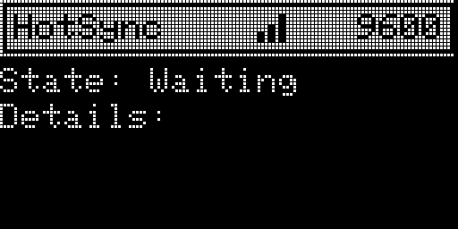

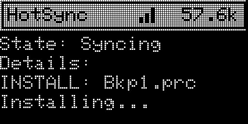

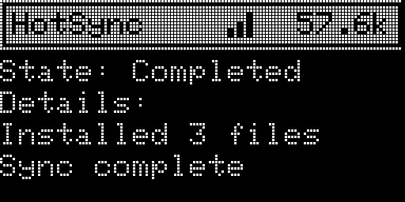

**SASD SDCard:** the card's **used/total** space and the live transfer speed. `SD:` is the SD card, `VD:` the virtual card, `SD: NOT PRESENT` means no card could be served (see the card section below).

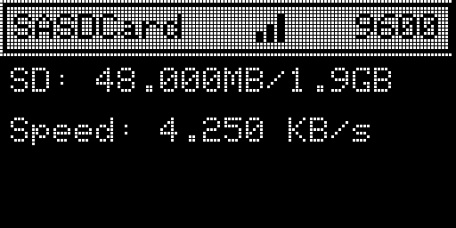

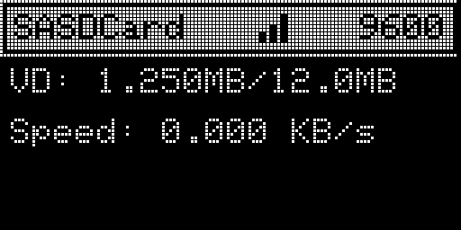

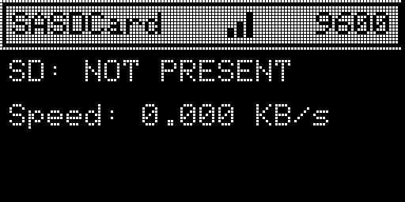

**SLIP Gateway:** `GW:` the gateway address (the WiRSa's end of the link), `CL:` the Palm's address, `WiFi:` the WiRSa's address on your network, and the number of open TCP and UDP connections.

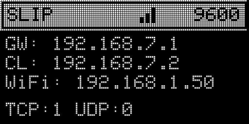

**BitWarden Relay and CalDAV Relay:** one line of status. BitWarden shows `Waiting...` (ready for the Palm app) and `Syncing...` during a sync. CalDAV shows `Preparing...` (first start after a boot), `Waiting...`, `Connecting...`, `Syncing...` and `Completed!` for each calendar, then `Waiting...` again. Errors are shown on the Palm, not here.

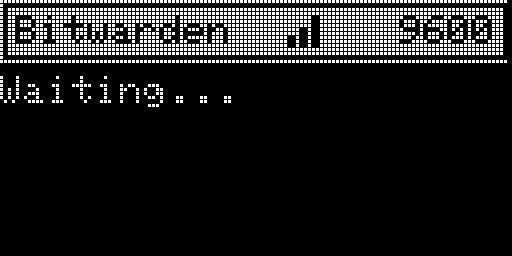

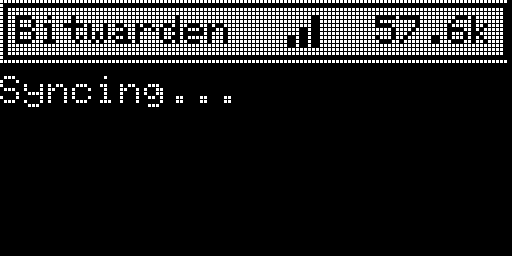

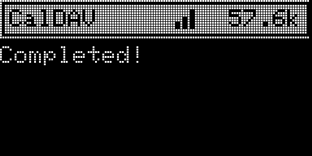

**Meshtastic:** the paired node's name, the link state (`Linked`, `Not linked`, `Link failed`, `Archived`, or "No node paired") and the number of messages held.

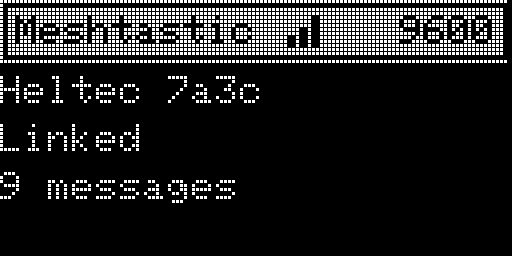

**FTP Server** has no screen of its own: it keeps running in the background and shows its menu (Stopped or Started):

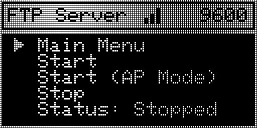

*The numbers and file names in these pictures are examples.*

### The other Config items
| Item | Use |
|---|---|
| **FTP Setup** / **AP Setup** | FTP user and password; the access point's name and password. |
| **SLIP Setup** | Gateway IP, client IP, DNS (UP/DOWN cycle digits and the dot, ENTER adds, BACK deletes, hold ENTER to accept, hold BACK to cancel). |
| **Baud Rate (Max)** | The fastest serial speed syncs may use (9600 to 115200). The menu itself starts at 9600. |
| **Orientation** | Normal or flipped screen. |
| **USB Debug** | Sends debug messages to the USB serial port. |
| **Exit Timers** | When a mode returns to the menu by itself. |
| **Factory Reset** | Erases all settings; asks first (ENTER to confirm, BACK to cancel). |
| **Reboot**, **About** | Restart; firmware information. |

## 2. Direct serial mode
The menus are the same, driven by letters. Use it when the unit has no screen or buttons, when you prefer a keyboard, or to see the log.

### Connect
1. Plug the USB cable into the board's USB-serial port and open the port at **115200, 8-N-1** in a terminal program.
2. Opening the port restarts some boards. Wait until the menu appears. If you miss it, press **Enter** or reset the board.
3. A **single letter** selects an item (no Enter needed, upper or lower case). The letters are in square brackets in the menu. Each menu ends with a prompt `>`.

The **Palm's serial line** shows the same menu, at 9600: a Palm terminal program (or WiRSaControl) can press the same letters. Keys sent from the Palm count only when they arrive on their own, so type them one at a time.

### The menus as the terminal shows them
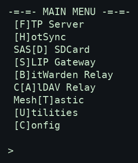

| Key | Does |
|---|---|
| `F` | FTP Server menu |
| `H` | HotSync |
| `D` | SASD SD card |
| `S` | SLIP Gateway |
| `B` | BitWarden Relay |
| `A` | CalDAV Relay |
| `T` | Meshtastic |
| `U` | Utilities |
| `C` | Config |

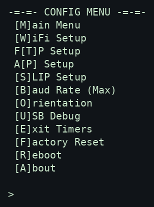

In Config: `W` WiFi Setup, `T` FTP Setup, `P` AP Setup, `S` SLIP Setup, `B` Baud Rate, `O` Orientation, `U` USB Debug, `E` Exit Timers, `F` Factory Reset (asks `Y`), `R` Reboot, `A` About, `M` back to the main menu.

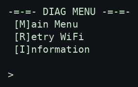

In Utilities (shown as "DIAG MENU"): `R` Retry WiFi, `I` Information, `F` Format SD Card, `M` main menu.

### First time: join your WiFi by typing
1. Press `C`, then `W`. The WiRSa prints `Scanning for WiFi networks...` and a lettered list of networks with signal stars, ending with `Cancel`.
2. Press the **letter** of your network.
3. For a protected network it prints `Enter password for: <name>` and `Password:`. Type the password and press **Enter** (Backspace corrects, **Esc** goes back to the list). What you type is echoed on the terminal.
4. It prints `Connecting to: <name>` and then `===== WiFi Connected =====` with the SSID, IP, gateway, DNS, signal and MAC address. Press any key to continue. A wrong password prints `Connection failed. Wrong password?`.
5. `I` in Utilities shows the connection again at any time.

### Run a mode by typing
Press the mode's letter from the main menu. The steps are the ones in the table above; only the leaving differs: **send `+++`** (three plus signs, quickly) or press the unit's BACK button to stop SASD or HotSync and return to the menu. Modes also return by themselves after their quiet time.

The **FTP Server** menu:

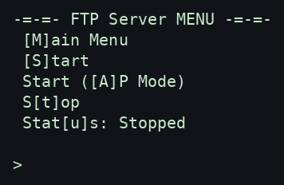

| Key | Does |
|---|---|
| `S` | Start (on your WiFi). It prints the card information and, when running, `FTP: server started (WiFi), <IP>`. |
| `A` | Start in access-point mode. |
| `T` | Stop. |
| `U` | Status: Started or Stopped (shown in the menu line). |
| `M` | Main menu. |

Then connect an FTP client to the printed IP. A typical session with the unit started from the terminal: `C`, `T` (set user and password), `M`, `F`, `S`, note the IP, connect, upload, `T`, `M`.

### Logs
The WiRSa prints a timestamped log on the USB port (turn it on with **USB Debug**, `C` then `U`, if you see nothing): WiFi events, FTP connections, mode starts and each sync. Lines look like `[62.467] I FTP: server started (WiFi), 192.168.1.189`. WiRSaControl > Help > Show Logs shows the same log on the Palm.

## 3. A screenless WiRSa: how it switches modes and returns to the menu
A WiRSa built without the OLED and buttons has no way to show or choose a mode itself, so the **Palm** does it, and the WiRSa **always comes back to its main menu by itself**. The main menu is the resting state: after every boot, and after every mode, it is there at **9600 baud**, waiting for the Palm.

### Starting a mode
| How | What happens |
|---|---|
| **A Palm app in Screenless Mode** ([BitWarden](Bitwarden.md), [CalDAV Sync](CalDAVSync.md), [Meshtastic](Meshtastic.md)) | Tick **Screenless Mode** in the app's Preferences. Before a sync the app pings the WiRSa, asks any other running mode to stop, asks for its own mode and waits (up to about 20 seconds) until that mode answers. If the WiRSa cannot be reached, or the mode does not come up, the app says so and does not sync. After the sync it sends the WiRSa back to the menu. |
| **[WiRSaControl](WiRSaControl.md) > Modes** | Pick the mode and tap **Start**. It starts the mode (HotSync, SASD, SLIP, CalDAV, BitWarden, Meshtastic). If another mode is running, it is stopped first. **Main Menu** + Start stops the running mode. The FTP server has its own Start and Stop switch. |
| **BOOT button** (on the board) | A short press starts **HotSync**, even in a screenless unit, to put apps back on a Palm that lost them. The red LED blinks three times when it starts, or once, long, when it did not (no card). A second press while it is still *Waiting* leaves it. |
| **Typed menu letters** | A Palm terminal program ([PocketTerm II](#test-the-palm-serial-line-with-pocketterm-ii), below) can press the menu letters, as in direct serial mode. |

The WiRSa must be at its main menu, or in a mode that answers the Palm (HotSync while waiting, and the three relays between sessions), to be told to switch. A mode in the middle of a transfer cannot be interrupted from the Palm.

### Coming back to the main menu
A mode ends in one of these ways:

| Mode | It returns to the menu when |
|---|---|
| **HotSync, CalDAV Relay, BitWarden Relay** | **No session starts** within the *Unused mode* time of entering it (default **45 s**), or **15 s** after a session ends (*After session*; a new session stops the countdown). A session ends at the Palm app's goodbye, when a relay hears nothing for 15 seconds, or when HotSync finishes. |
| **Meshtastic** | You close the Palm app, which takes the WiRSa back to the menu (or to the background node, if one is set, see [Meshtastic](Meshtastic.md)). In Session mode, the same *Exit Timers* end it if the Palm stops answering. |
| **SLIP Gateway** | **No traffic** either way for the SLIP timeout: **1, 2, 3 or 5 minutes** (default 5). It counts from the start, so a Palm that never connects also times out. |
| **SASD SDCard** | **Nothing heard from the Palm** for the SASD timeout: **3, 5, 10 or 15 minutes** (default 3). The Palm's SASD driver keeps the serial port open, so WiRSaControl **cannot** end SASD; it ends by the timer, or by resetting the WiRSa. The Palm then reports "no card" at its next card access. |
| **Any mode** | **Reset** (power off and on, or the board's reset button). The WiRSa is back at the menu at 9600. |

All the times are in **WiRSaControl > Setup > Exit Timers** (or **Config > Exit Timers** on a unit with a screen). A time of 0 means never.

### Knowing where it is
- **WiRSaControl's main screen** shows the **Mode** (`Main Menu`, `HotSync`...), refreshed every 15 seconds. After a start it shows the mode with "(last known)" until the next refresh.
- **The LED** shows only traffic, not the mode (see the LED table in section 5). Blue steady with green flickers means the Palm line is busy.
- If the Palm cannot find the WiRSa, it may still be in a mode that does not answer (SASD, SLIP). Wait for the timer or reset it.

## 4. Which card is used, and how much space is there
The WiRSa has two places to keep files, and only some modes can use both.

| Card | What it is | Size |
|---|---|---|
| **SD card** | A micro SD card in the unit's slot, formatted **FAT16** or **FAT32** (cards up to 2 GB are FAT16, bigger ones FAT32). | Whatever the card is. |
| **Virtual card** | A part of the WiRSa's own flash memory that acts as a card. It is always there, is formatted the first time it is used, and has the volume name **ESP32**. | About **12 MB** (a FAT16 volume with 2 KB clusters, 11.9 MB usable). |

### Which card each mode uses
| Mode | Card used |
|---|---|
| **SASD SDCard** | **One** card, chosen by **Setup > Disk** in WiRSaControl: **Auto** (the SD card if one answers, otherwise the virtual card), **SD card** (SASD refuses to start without one: "PLEASE INSERT SD CARD") or **Virtual** (the SD card is not touched). The Palm sees one card at a time: change the setting and start SASD again to switch. |
| **HotSync** | The same Disk setting. It installs from `/PALM/PROGRAMS/INSTALL` and `/SASD` of that card, and creates those folders when they are missing. |
| **FTP Server** | **Both**, always: the root of the FTP site has two folders, **SDCard** (only when an SD card is in) and **ESP32**, the virtual card. The Disk setting does not apply. Files cannot be renamed from one card to the other (copy them instead). |
| **Meshtastic** | The **SD card** only, for message history and the spool while the WiRSa sleeps (folders `/Meshtastic/<node id>/`). Without a card only a small buffer survives sleep. |
| **SLIP, BitWarden, CalDAV** | No card. |

The Disk setting rule in one line: **Auto** means the SD card whenever it answers, and the virtual card otherwise. Use **Virtual** to keep the SD card out of the way, **SD card** to be sure the big card is used.

### Where to see the free space
- **On the WiRSa's screen,** in SASD mode: `SD: 48.000MB/1.9GB` (used/total) or `VD: 1.250MB/12.0MB` for the virtual card, and `SD: NOT PRESENT` when there is nothing to serve.
- **On the Palm,** in WiRSaControl's main screen, the **SD** (or **V. SD**) row: used/total of the card the Disk setting selects. With **Auto** it says `Card` or `Virt` in front of the numbers. Other messages: `Not present`, `Not formatted` (virtual card, before first use), `Unknown`.
- **Utilities > Information** ends with the disks: `Disk:` (the Disk setting), `SD:` used/total (or `Not present`) and `V. SD:` used/total of the virtual card (or `not formatted`).
- **Over FTP and the terminal,** starting the FTP server prints the SD card's type and its total and used space.
- **Palm file managers** (Mgr1, Bkp1) can show the card's size and free space once SASD is running.

Numbers are in powers of 1024 (KB, MB, GB). The used space is counted from the card's file table when the card has been **quiet for 3 seconds**, so it can lag a little during a transfer. A card that is not FAT16 or FAT32 (FAT12, exFAT) shows its **total only**.

### Formatting the SD card
**Utilities > Format SD Card** erases the SD card: a new partition and an empty FAT16 volume for cards up to 2 GB, FAT32 above. In the terminal press `F`, then `Y` to confirm; on the buttons choose the item, then ENTER. Any other key (or BACK) cancels, and so does waiting 15 seconds. Stop the FTP server first: it refuses while FTP runs.

The WiRSa then copies the **SASD install set** from the virtual card (`/PALM/PROGRAMS/SASD`) onto the new card, checking each file, and says how many were copied. WiRSaControl does the same from **Options > Format SD Card...**.

The **virtual card cannot be formatted**, from the menu or from WiRSaControl: it holds the files a blank Palm is set up from (the HotSync install folder and the SASD set), and they could only come back over FTP.

### Limits to know
- **12 MB is small.** A full Bkp1 backup of a big Palm may not fit on the virtual card; use the SD card for backups.
- **Keep files in folders** on the virtual card: its root directory holds only about 127 long file names.
- The virtual card is flash: write each file completely and end a session normally (BACK or the quiet-time exit). A reset in the middle of a transfer can leave a partial file, as with any card.
- The SD card and the virtual card **cannot both be visible to the Palm** at the same time.
- **SASD and the FTP server cannot run together** (they use the SD card in incompatible ways). FTP and HotSync can.

## 5. The status LED
A colour LED (not the screen) shows what the radios and the Palm line are doing. It has no state of its own for a mode: HotSync, SASD, SLIP and the relays show only through the traffic they cause.

| Colour | Steady | Flickers on |
|---|---|---|
| **Blue** | WiFi is up (connected, or the access point) or the Bluetooth link to a Meshtastic node is up. With **Wifi Pulse** set to *Always On* it is steady; otherwise it is dark with a short blink at the chosen interval. | WiFi traffic from the WiRSa itself, or Bluetooth traffic (a brief dark dip) |
| **Green** | off | Serial traffic with the Palm, either direction |
| **Red** | off | SD card traffic |

Each flicker lasts 30 ms, so heavy traffic shows as a steady fast flicker. The **BOOT** button (HotSync) blinks red three times, one second on and one off, when HotSync starts; a single long red blink means it did not start (no card). **Wifi Pulse** (WiRSaControl > Setup) is *Always On*, *15s*, *30s* (the default), *1min* or *Never*. The LED is dark in deep sleep.

## 6. Troubleshooting
### Test the Palm serial line with PocketTerm II
When a Palm app cannot find the WiRSa, check the **serial line itself** first, with nothing between them but a terminal program. **PocketTerm II** (or any Palm terminal) is a good tool: if you can see the WiRSa's menu on the Palm and change it by typing, the cable and the TTL lines work in **both directions**.

1. **Connect** the Palm's serial cable to the WiRSa as you do for a sync. Power the WiRSa and wait until it is at its main menu. (After any reset the menu is at **9600**; if WiRSaControl has run since, it may be at your Palm's own speed, see step 5.)
2. In PocketTerm II open the settings and use **9600 baud, 8 data bits, no parity, 1 stop bit, no flow control** (hardware handshaking off: the WiRSa does not use RTS/CTS). Open the port.
3. **WiRSa to Palm (receive line).** **Reset the WiRSa** with the terminal open (or press the unit's reset button). Its start-up text and then the main menu appear:

   ```
   -=-=- MAIN MENU -=-=-
    [F]TP Server
    [H]otSync
    ...
   >
   ```

   Garbled characters mean the **speed is wrong** (try the other rates, or reset the WiRSa and use 9600). Nothing at all means the WiRSa's transmit line, the cable or the Palm's serial port is not working.
4. **Palm to WiRSa (transmit line).** Type a single menu letter, for example `U` (Utilities): the menu changes to the Utilities menu, and `M` takes you back. Type **one letter at a time and wait**: a letter only counts when nothing else arrives within 100 ms before and after it (a Return after it is fine), so pasting or fast typing is ignored on purpose. If the menu never changes, the WiRSa is not hearing the Palm: check the transmit line and the speed. If every letter shows twice, turn the terminal's **local echo** off.
5. **Try another speed.** The menu can be moved from the terminal. At 9600 type the line `SETBAUD` and press Return: the WiRSa answers `OK`. Then type `BR57600` (or `BR115200`, `BR38400`, `BR28800`, `BR19200`, `BR14400`) and Return: it answers `OK` and the menu now runs at that rate, so **change the terminal to the same speed** and press Return to see the menu again. If the line is wrong, you get `ERROR` and the menu goes back to 9600. The WiRSa returns to the speed it had before once the line has been quiet for 10 seconds or a mode ends.

   | If you see | It means |
   |---|---|
   | `OK` after `SETBAUD` | The WiRSa hears the Palm at the terminal's speed. |
   | `ERROR` after `BR...` | The number does not match the measured speed: set the terminal and the `BR` rate the same. |
   | Nothing after typing | The Palm's transmit line (or its speed) is not reaching the WiRSa. |

6. **Leave** the terminal before you start a Palm app: the port can be open in only one program at a time.

The USB console shows the same conversation (the line the WiRSa received, the speed it measured, and why a `BR` was refused), so with the unit connected to a computer you can follow both ends at once.

### Other checks

| Symptom | Try |
|---|---|
| Nothing on the terminal | Check the port and 115200 8-N-1; press Enter; reset the board. |
| Cross instead of bars in the title bar | WiFi gave up: Utilities > Retry WiFi, or redo WiFi Setup. |
| "PLEASE INSERT SD CARD" | The Disk setting is SD card and none is in: insert one or set Disk to Auto or Virtual (WiRSaControl > Setup). |
| Palm says no card after SASD | SASD ended (quiet time or Back). Start it again. |
| Palm cannot find the WiRSa | Same speed on both ends: the menu starts at 9600; open WiRSaControl and tap Find WiRSa. |
| FTP will not start | Needs WiFi (or AP mode); cannot run during SASD. |

*The screen images above are drawn by `docs/tools/wirsa_oledshot.py` from the firmware's own menu code and font (white on black, as on the real glass), not photographed.*
