# WiRSaControl (WiRSaCtl)

Shows and controls the **WiRSa** from the Palm, so you do not need its buttons, its screen or a terminal. Plug the Palm's serial cable into the WiRSa and open **WiRSaCtl**. It finds the WiRSa by itself, and refreshes every 15 seconds while it is on screen. The WiRSa has to be at its **main menu** (or in a mode that is waiting for the Palm).

## Main screen

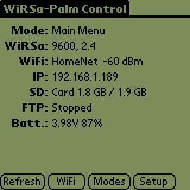

| Row | Shows |
|---|---|
| **Mode** | The WiRSa's current mode (Main Menu, HotSync, SASD and so on). |
| **WiRSa** | The speed it listens at and its firmware version. A screenless unit says "no screen". |
| **WiFi** | The network it is on and the signal. |
| **IP** | Its address, for FTP and the Google sign-in. |
| **SD / V. SD** | The card in use: used and total space. Shows **V. SD** when the built-in virtual card is the disk. |
| **FTP** | Started or Stopped. |
| **Batt.** | Battery voltage and percent, if it has one. |

If the WiRSa does not answer, the screen says why (cable, power, or a mode that is busy) and asks again every 15 seconds. **Refresh** asks at once.

## WiFi
**WiFi** scans for networks, lists up to 16 with their signal, and fills in the SSID when you tap one. Type the password (it is hidden, with the character you just typed shown for a second; tick **Show password** to see all of it) and tap **Connect**. The WiRSa tests the network and saves it only if it connects. The password travels encrypted.

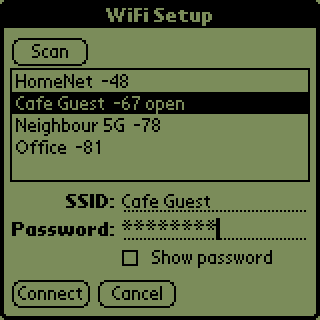

## Modes
**Modes** starts a mode without touching the WiRSa. Pick it in **Select Mode:**; a short note under it says what it does and how it ends. **Start** runs it and returns to the main screen.

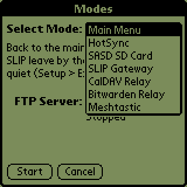

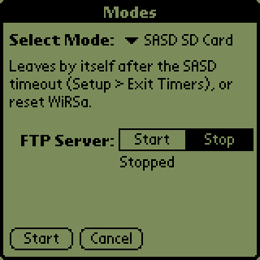

| Mode | What it is for |
|---|---|
| **Main Menu** | Leave the running mode. |
| **HotSync** | Install apps from the card to the Palm. |
| **SASD SD Card** | Serve the card to the Palm ([SASD](SASD.md)). Asks first; it ends by itself after its quiet time, or when you reset the WiRSa. |
| **SLIP Gateway** | Network access for the Palm. Asks first, ends by itself when quiet. |
| **CalDAV Relay**, **Bitwarden Relay**, **Meshtastic** | The modes for those apps. The apps start them themselves in Screenless Mode. |

The **FTP Server** switch (**Start** / **Stop**) acts at once and works in the background.

## Setup
**Setup** is the WiRSa's own settings, saved with **OK**.

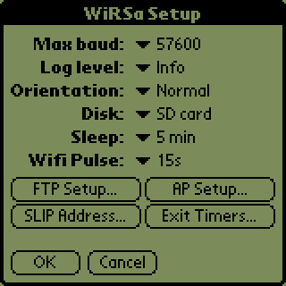

| Setting | Meaning |
|---|---|
| **Max baud** | The fastest serial speed for syncs (9600 to 115200). |
| **Log level** | Off, Warn, Info or Verbose, for the log. |
| **Orientation** | Normal or Flipped screen (not on a screenless unit). |
| **Disk** | Which card SASD and HotSync use: **Auto** (the SD card if there is one, else the virtual card), **SD card** or **Virtual**. |
| **Sleep** | Deep sleep after this long at the menu (needed for Meshtastic Background mode). |
| **Wifi Pulse** | How the blue LED shows that WiFi is up: Always on, every 15 s, 30 s, 1 min, or never. |

Four more forms open from here:

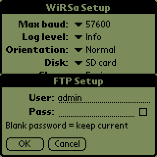

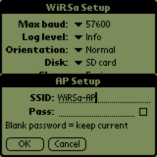

- **FTP Setup:** the FTP user name and password. A blank password keeps the current one.
- **AP Setup:** the name and password of the WiRSa's own access point (used by FTP's AP mode). Blank keeps the current password.

Both password fields show `*`s, with the character you just typed in clear for a second; the checkbox at the right of the field shows the whole password.

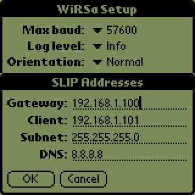

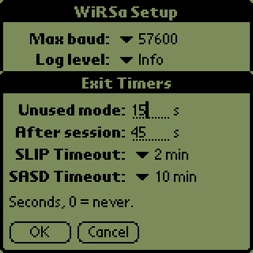

- **SLIP Address:** the gateway, client, subnet and DNS addresses of the SLIP link.
- **Exit Timers:** how long a mode waits before the WiRSa returns to its menu by itself. **Unused mode** (a mode nobody started a session in) and **After session** are in seconds, 0 meaning never. **SLIP Timeout** is 1, 2, 3 or 5 minutes; **SASD Timeout** 3, 5, 10 or 15 minutes.

## Options and Help menus

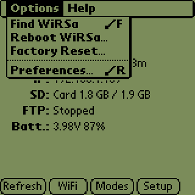

- **Find WiRSa** searches every serial speed. Use it if the WiRSa was changed or is not found.
- **Reboot WiRSa...** restarts it, after asking: a HotSync, SASD card or SLIP link in use is cut off.
- **Factory Reset...** asks first, then erases all WiRSa settings (WiFi, FTP, SLIP, baud) and restarts it.

  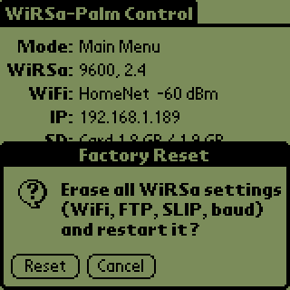

- **Format SD Card...** erases the SD card in the WiRSa: FAT16 for cards up to 2 GB, FAT32 above. Leave **Copy the SASD install set from the virtual card** ticked to put the SASD files (`/PALM/PROGRAMS/SASD`) back on the new card, so a Palm can install the SASD driver from it. Stop the FTP server first: the WiRSa refuses while it runs. A 1 GB card takes a few seconds, a large FAT32 card longer; the app waits up to 4 minutes. The virtual card cannot be formatted, here or on the WiRSa, because a blank Palm is set up from its files.

  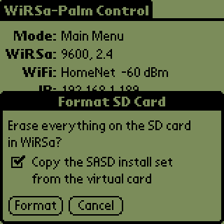

  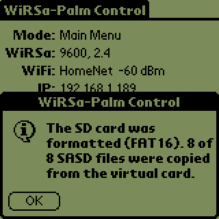

- **Preferences...** sets **Pref Baud**, the fastest speed this Palm can use. When it is above 9600 the app moves the WiRSa's menu up to it. If that speed does not work on your line, it tries the next lower ones (57600, 38400 ...) until one does.

  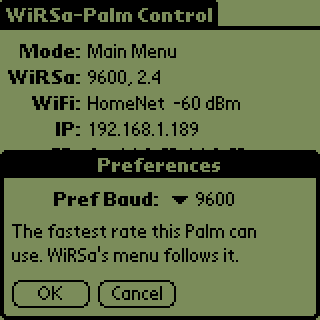

- **Help > System** shows the WiRSa's chip, memory, uptime and firmware.

  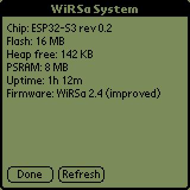

- **Help > Show Logs** shows the WiRSa's session log, newest at the bottom, with **Refresh** and **Clear** (which asks first).

  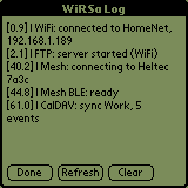

## Screenless mode
A WiRSa built **without a screen or buttons** is run entirely from the Palm. In [BitWarden](Bitwarden.md), [CalDAV Sync](CalDAVSync.md) and [Meshtastic](Meshtastic.md) tick **Screenless Mode** and the app starts the right mode, runs, and returns the WiRSa to its menu. WiRSaCtl is the place to set it up the first time (WiFi, FTP, Setup).
